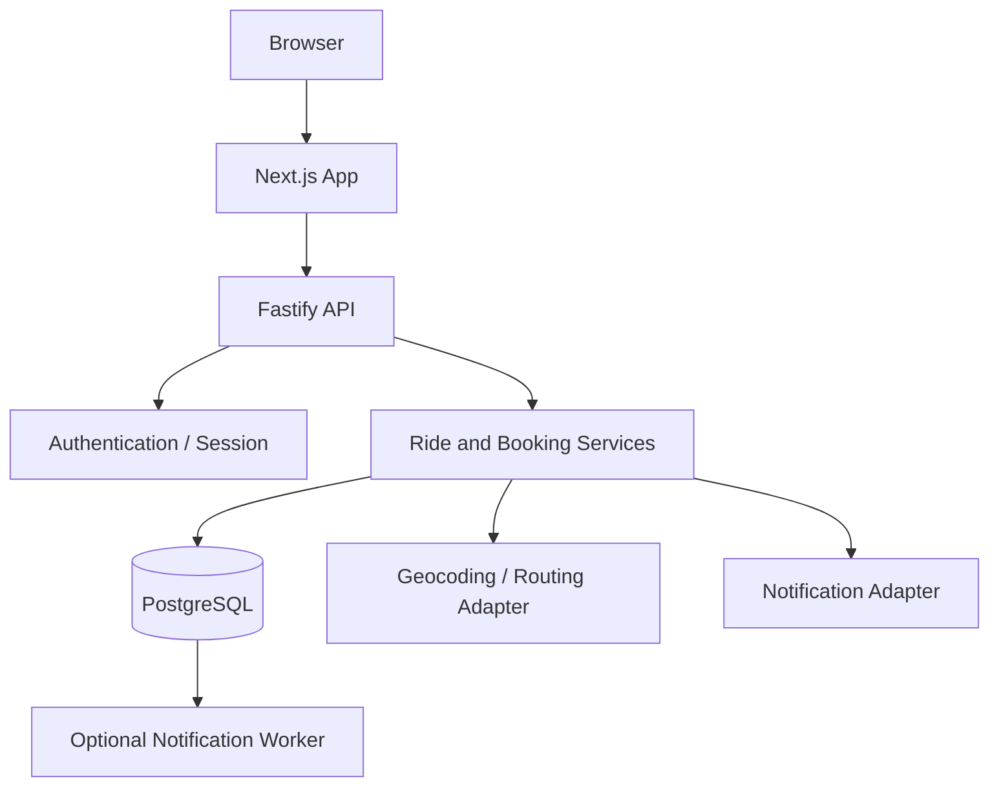

# RouteMitra — System Architecture

**Status:** Proposed MVP architecture  
**Principle:** Prefer simple, testable boundaries over premature microservices.

## 1. System overview

RouteMitra is a responsive web marketplace. Next.js renders the user experience, Fastify exposes the API, and PostgreSQL is the eventual source of truth for rides and bookings. The initial scaffold exposes a health endpoint only; the domain services and persistence described here are target design, not completed implementation.



## 2. Monorepo structure

```text
routemitra/
├── apps/
│   ├── web/                  # Next.js App Router
│   └── api/                  # Fastify API
├── packages/
│   └── shared/               # Shared domain types/schemas
├── infrastructure/
│   └── docker-compose.yml    # Local PostgreSQL
├── docs/
│   ├── decisions/            # ADRs
│   └── operations/           # Runbooks
├── PRD.md
├── Architecture.md
├── Architecture-essentials.md
├── AGENTS.md
├── CLAUDE.md
├── pnpm-workspace.yaml
└── turbo.json
```

Database and UI packages may be added when implementation justifies them; do not create empty abstractions just to match a diagram.

## 3. Technology

- **Web:** Next.js App Router, React, TypeScript strict mode, Tailwind CSS.
- **Forms:** React Hook Form and Zod for multi-step forms and validation.
- **Remote state:** TanStack Query for API state/caching. Zustand only for genuinely shared client interaction/draft state.
- **Maps:** MapLibre GL JS behind a provider adapter. Core search cannot depend on map availability.
- **API:** Node.js, Fastify, runtime validation, structured logs, rate limits.
- **Database:** PostgreSQL with Drizzle ORM and checked-in migrations.
- **Tests:** Vitest for domain/unit tests and Playwright for browser journeys.
- **Local services:** Docker Compose. Redis/queues are deferred until a durable asynchronous use case exists.
- **CI:** lint, typecheck, unit/integration tests, and build.

## 4. Domain boundaries

### Identity
Owns authentication sessions, user profiles, and account state. Verification must reflect a real provider/process, not a client-set boolean.

### Vehicles
Owns a driver's vehicle summaries. Minimize stored sensitive vehicle/registration information in the MVP.

### Rides
Owns driver, origin, destination, route stops, departure time, vehicle, contribution, seat inventory, and published/cancelled/departed/completed lifecycle.

### Bookings
Owns passenger, ride, requested seats, decision/cancellation state, and timestamps. The booking domain enforces capacity and state transitions transactionally.

### Reviews and reports (later)
Reviews require a valid completed journey and abuse/moderation policies. Reports are private and exposed only to the reporter and explicitly authorized moderators.

### Maps and routing
An adapter normalizes provider geocoding and routing results. Keep vendor-specific objects out of the domain model. Respect attribution, provider terms, quota, and commercial use requirements.

### Notifications
Initially can be a no-op/local adapter in demo mode. When implemented, booking-created/accepted/declined/cancelled notifications should be durable. A failed notification must not undo a committed booking; use an outbox/queue before claiming reliable delivery.

## 5. Logical data model

### `users`
`id`, `display_name`, normalized `email`, optional protected `phone`, optional `avatar_url`, `account_status`, timestamps. Authentication-provider schema may be managed by the selected library.

### `vehicles`
`id`, `owner_user_id`, `make`, `model`, `colour` (optional), `seat_capacity`, timestamps.

### `rides`
`id`, `driver_user_id`, `vehicle_id`, normalized origin/destination, `departure_at`, optional arrival estimate, canonical seat inventory, `contribution_minor`, `currency_code`, `status`, bounded notes, timestamps.

### `ride_stops`
`id`, `ride_id`, `sequence`, normalized location, optional time estimate. Unique `(ride_id, sequence)`.

### `bookings`
`id`, `ride_id`, `passenger_user_id`, `requested_seats`, status (`pending | accepted | declined | cancelled | completed`), contribution/currency snapshot, decision/cancel timestamps. Add constraints/indexes to reject duplicate active requests where appropriate.

### `reviews` and `reports` (P1)
Store minimum required fields. Reports must remain private. Reviews are permitted only under explicit eligibility rules.

## 6. Seat inventory and transaction rules

PostgreSQL is authoritative. Choose one inventory model:
- store and transactionally update `available_seats`, or
- store total capacity and derive accepted reservations with concurrency-safe locking/updates.

Do not treat both as independently editable sources of truth.

When accepting a booking:
1. Begin transaction and lock the ride row or use a conditional atomic update.
2. Re-read ride and booking status.
3. Confirm actor owns the ride, booking is pending, ride is published and in the future.
4. Confirm capacity for requested seats.
5. Transition booking and update canonical inventory exactly once.
6. Commit; then enqueue notification (use an outbox for durable production delivery).

Cancellation follows the same pattern. Parallel requests for the last seat and repeated actions must be tested. UI optimistic updates may improve responsiveness but must reconcile with server results.

## 7. API design outline

Use prefix `/api/v1`.

### Public
- `GET /health`
- `GET /api/v1/rides?origin=...&destination=...&date=...&seats=...`
- `GET /api/v1/rides/:rideId`

### Authenticated
- `POST /api/v1/rides`
- `PATCH /api/v1/rides/:rideId`
- `POST /api/v1/rides/:rideId/cancel`
- `GET /api/v1/me/rides`
- `GET /api/v1/me/bookings`
- `POST /api/v1/rides/:rideId/bookings`
- `POST /api/v1/bookings/:bookingId/accept`
- `POST /api/v1/bookings/:bookingId/decline`
- `POST /api/v1/bookings/:bookingId/cancel`

### Later
- Reviews, reports, saved searches, chat, recurring rides, notification preferences.

Validate UUIDs/IDs, enums, date/time, bounds, and text lengths. Paginate results. Return a consistent error envelope with stable code, safe message, and request ID. Do not expose stack traces or database details in production responses.

## 8. Frontend state and directories

```text
apps/web/app/
  (marketing)/
  (auth)/
  rides/
    page.tsx
    [rideId]/page.tsx
  publish/page.tsx
  dashboard/
  bookings/
apps/web/components/
  layout/
  rides/
  booking/
  forms/
  maps/
apps/web/features/
  ride-search/
  ride-publishing/
  bookings/
apps/web/lib/
  api-client.ts
  validation/
```

State ownership:
- URL search params: shareable search criteria.
- TanStack Query: server state and caching.
- React Hook Form: form draft and validation state.
- Local React state: component-level interactions.
- Zustand: only shared client-side interaction state, such as multi-step draft/editor state.

Do not replicate server-owned booking entities across independent client stores.

## 9. Auth, authorization, and security

- Choose one authentication/session strategy and document it.
- Resolve current user from a verified session/token on every private endpoint.
- Enforce object-level permissions: passengers see their own bookings; drivers manage only their own rides/requests.
- Public trip responses must not expose email, phone, private address, verification evidence, reports, or internal moderation data.
- Apply CSRF protection appropriate to cookie/session strategy.
- Rate-limit signup/login/booking endpoints and cap payload size.
- Keep all secrets server-side and out of client bundles.
- Do not collect payment credentials or identity documents in the MVP.

## 10. Search, matching, and maps

Start with exact origin/destination matching, date and seat filters, then add ordered stop-segment matching.
When segment matching is added:
1. Represent the ride as an ordered sequence of normalized places.
2. Find passenger boarding/alighting places in that order.
3. Obtain route distance/time from provider where available.
4. Exclude or warn about excessive detours according to configuration.
5. Mark values as estimates and allow driver confirmation.

Routing/geocoding adapters should be swappable. Search must work when map tiles fail or a provider is unavailable. Never assume a free map/tiles endpoint permits unrestricted commercial production traffic.

## 11. Reliability and observability

- Request ID on each request.
- Structured logs that redact secrets and unnecessary personal/location data.
- Central error handling and safe client messages.
- Database health check and explicit migrations.
- Timeouts for map/notification service calls.
- Retry only idempotent operations or writes protected by idempotency/state guards.
- Durable outbox/queue for important notifications before production reliability claims.
- Do not show a success toast when the backend rejected the action.
- Use explicit API error types; preserve actionable retry flows.

## 12. Test plan

**Unit:** matching, fares, inventory, state transitions, schema validation, authorization policy.

**Integration:** real test PostgreSQL, concurrent booking acceptance, cancellation restoration, constraints, API auth and ownership.

**E2E:** search → detail → request; driver accepts/declines; cancellation; ride publishing; mobile layouts; empty/error/retry states.

Required edge cases:
- no seats; parallel requests for final seat; duplicate request; driver books own ride;
- non-owner edits ride or accepts request; ride departs/cancels mid-flow;
- repeated accept/cancel; invalid/past date; timezone boundary;
- map provider down; database conflict; notification failure.

## 13. Operations and deployment

- `.env.example` includes variable names and safe descriptions only.
- Local PostgreSQL via Docker Compose.
- Commit schema migrations; run migration as an explicit deployment step.
- Seed data deterministic, labelled, and disabled in production by default.
- CI: install, lint, typecheck, tests, build.
- Production needs TLS, backups/restore tests, monitoring, retention policies, secrets management, and incident procedures.

## 14. Use ADRs for these decisions

- Auth provider/session strategy.
- Canonical seat-inventory model.
- Whether pending requests hold seats.
- Maps/geocoding/routing provider.
- Notification outbox/queue.
- Local-first draft persistence vs server persistence.
- Legal launch model, payment scope, and supported launch jurisdiction.
